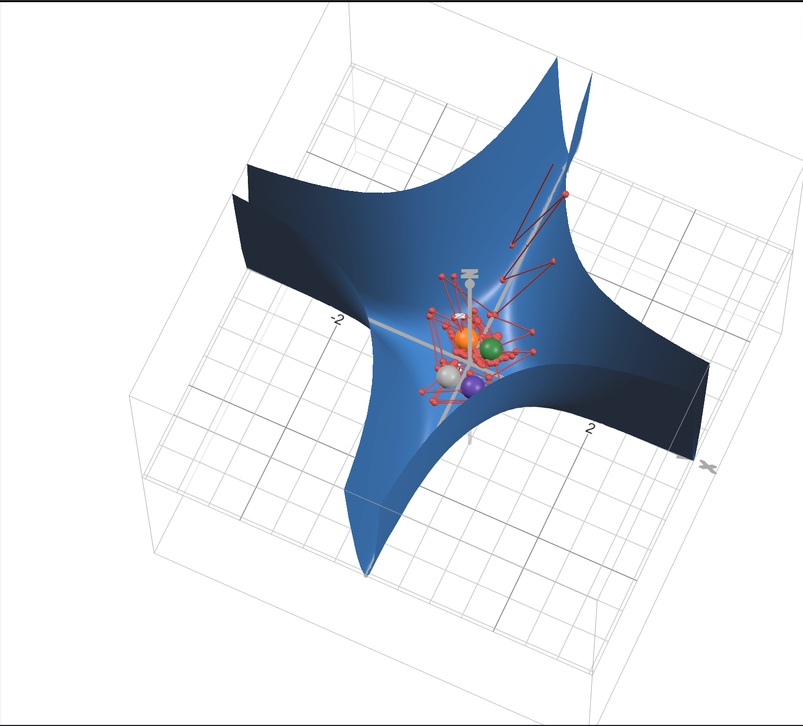
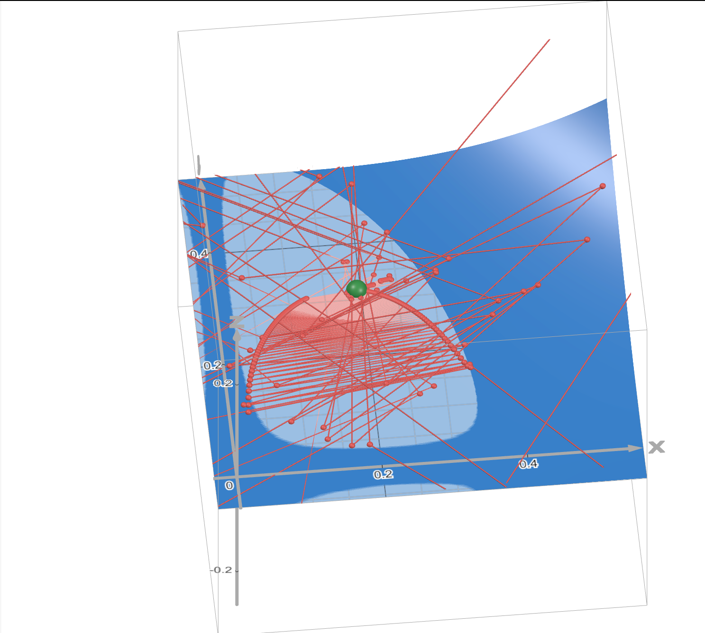
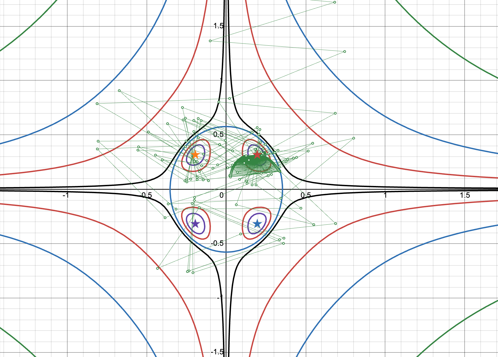
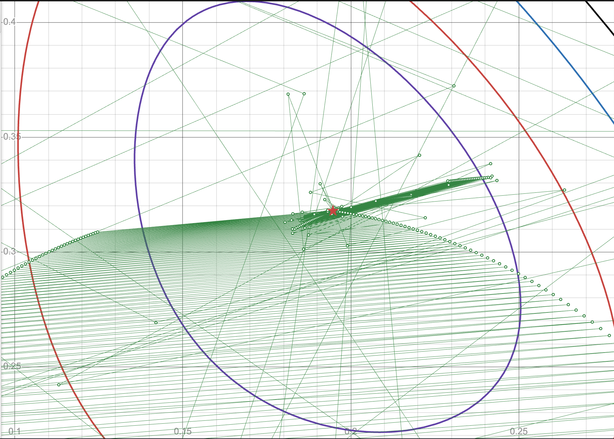

# Градиентный спуск для функции двух переменных

Исследуемая функция:

$$f(x, y) = x^2 y^2 \ln(8x^2 + 3y^2)$$

## Аналитическая часть

Стационарные точки внутри эллипса $8x^2 + 3y^2 < 1$ находятся аналитически. Строгие локальные минимумы:

$$A = \left(\frac{1}{4e^{1/4}},\ \frac{1}{\sqrt6\, e^{1/4}}\right) \approx (0.1947,\ 0.3179), \qquad f(A) = -\frac{1}{192e} \approx -1.916\cdot10^{-3},$$

и симметричные ей точки $C = (-x_A, y_A)$ и т. д. Кроме того, на осях вне эллипса функция имеет бесконечное множество нестрогих минимумов ($f = 0$).

## Численная часть

Реализован градиентный спуск с аналитическим градиентом и настраиваемыми параметрами:

- нормировка градиента (длина шага не зависит от величины градиента);
- режимы шага: постоянный, линейно убывающий $a_k = a_0/(1+0.01k)$, геометрически убывающий $a_k = a_0 q^k$;
- критерии остановки: по приращению функции $\lvert\Delta f\rvert < \varepsilon$ и по приращению координат $\lVert\Delta x\rVert < \delta$.

## Эксперименты

| # | Шаг | Критерий | Итераций | Результат |
|---|---|---|---:|---|
| 1 | const, без нормировки | $\lvert\Delta f\rvert$ | 100 | расходится |
| 2 | linear, нормировка | $\lVert\Delta x\rVert$ | 1000 | не сходится: шаг убывает слишком медленно |
| 3 | const 0.1, нормировка | $\lvert\Delta f\rvert$ | 1000 | осцилляция между окрестностями $A$ и $C$ |
| 4 | geom, $\delta = 10^{-3}$ | $\lVert\Delta x\rVert$ | 689 | сходится к $A$ |
| 5б | geom, $\varepsilon = 10^{-6}$ | $\lvert\Delta f\rvert$ | 116 | **ложная остановка** вдали от минимума |
| 6 | geom, старт $(7, 7)$ | $\lVert\Delta x\rVert$ | 1000 | сходится к симметричному минимуму $C$ |
| 7 | geom, старт $(10, 5)$ | $\lVert\Delta x\rVert$ | 1000 | сходится к нестрогому минимуму $(3.82, 0)$ |
| **8** | **geom, $\delta = 10^{-4}$** | $\lVert\Delta x\rVert$ | **918** | **сходится к $A$, ошибка $7.0\cdot10^{-5}$** |

**Выбор параметров главного эксперимента.** При нормированном градиенте и геометрическом шаге $\lVert\Delta x_k\rVert = a_0 q^k$, поэтому критерий срабатывает предсказуемо на итерации

$$k > \frac{\ln\delta - \ln a_0}{\ln q} \approx 916.4 \quad (a_0 = 1,\ q = 0.99,\ \delta = 10^{-4}),$$

что согласуется с фактическими 918 итерациями.

## Выводы

- Метод с нормированным градиентом и геометрическим убыванием шага находит минимум $A$ с отклонением $7\cdot10^{-5}$ по координатам и $8\cdot10^{-10}$ по значению функции примерно за 8 мс.
- Критерий $\lvert\Delta f\rvert$ ненадёжен на функциях с пологими участками: он срабатывает задолго до приближения к минимуму.
- В зависимости от стартовой точки метод сходится к разным стационарным точкам, в том числе к нестрогим минимумам на осях.

## Визуализация

Траектория экспортируется из ноутбука в TSV и отрисовывается в Desmos.

*Красные точки — траектория спуска, зелёная — точный минимум $A$.*

*Зелёные точки — траектория, звёзды — аналитические минимумы.*

Интерактивные версии: [3D-поверхность](https://www.desmos.com/3d/lle7gw77xt) · [линии уровня](https://www.desmos.com/calculator/rtwqc572nr)

## Файлы

- `gradient_descent.ipynb` — реализация, все эксперименты и подробные комментарии к ним.
